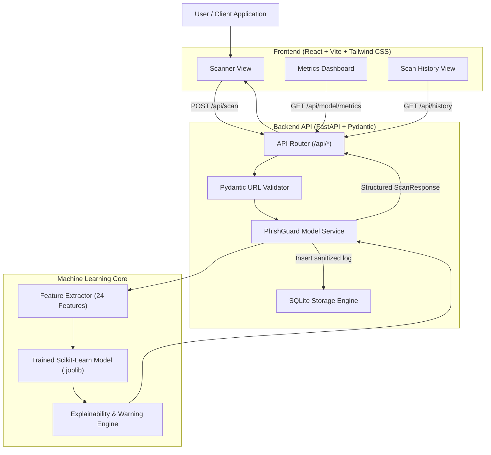

# PhishGuard — System Architecture Documentation

## 1. System Overview

PhishGuard is a privacy-preserving, fetch-free machine learning screening system designed to detect malicious phishing URLs before users interact with them. The system operates on lexical, syntactic, and structural properties extracted directly from user-submitted URL strings, deliberately avoiding fetching the destination webpage to protect client infrastructure from drive-by downloads, tracking beacons, and browser exploitation.

---

## 2. Architectural Principles

1. **Zero Outbound Network Footprint (Fetch-Free Inspection):**
   PhishGuard never executes network handshakes, DNS queries, or HTTP GET/POST requests against the suspect URL during screening. This eliminates the risk of alerting adversaries to scanning activity or downloading malicious payloads.

2. **Deterministic Feature Pipeline:**
   Feature extraction logic is shared verbatim between offline training (`training/feature_extraction.py`) and live inference (`app/ml/feature_extractor.py`). This guarantees zero train-test feature distribution skew.

3. **Multi-Tiered Explainability:**
   In addition to returning class probabilities and categorical verdicts (`Potentially Phishing` vs. `Potentially Legitimate`), the model correlates input characteristics with human-interpretable heuristics (such as `@` credential abuse, IP address hostnames, or deep subdomain nesting).

4. **Privacy-Preserving Audit Logging:**
   The optional SQLite persistence engine strips query strings and sensitised path segments to avoid storing access tokens, session IDs, or private user parameters.

---

## 3. Component Details

### 3.1 Frontend Architecture (React 18 + TypeScript + Vite)
- **Single Page Application (SPA):** Uses tabbed state management to swap between Scanner, Model Metrics, Scan History, and Educational Overview without heavy client-side routing overhead.
- **Tailwind CSS Design System:** Implements an accessible cybersecurity UI palette (Dark Navy `#0a0f1e`, Charcoal slate `#0d1526`, Cyan accents `#06b6d4`, and semantically tinted warning badges).
- **Graceful Connectivity Feedback:** An integrated navbar health pill pings `/api/health` on initial mount to warn the user if the backend service is offline.

### 3.2 Backend Architecture (FastAPI + Uvicorn)
- **Application Factory & Lifespan Management:** Initializes the SQLite database and loads the serialized `.joblib` model artifact into memory once at server startup, eliminating model deserialization latency during individual requests.
- **RESTful Endpoints:**
  - `GET /api/health`: Node and model readiness status.
  - `POST /api/scan`: Ingestion, feature extraction, inference, and audit logging.
  - `GET /api/model/metrics`: Real-time export of model training metrics and confusion matrix.
  - `GET /api/history`: Retrieval of recent scan audits.
  - `DELETE /api/history`: Safe purge of stored audit records.

### 3.3 ML Inference Pipeline
- **Input Sanitization:** Verifies scheme presence, trims excessive whitespace, and clamps lengths under 2,048 characters.
- **Feature Vector Generation:** Extracts a 24-dimensional feature vector encompassing length metrics, character counts, structural indicators, and Shannon entropy.
- **Decision Engine:** Evaluates likelihood using trained estimators (Logistic Regression or Random Forest), classifies risk categories (`high`, `medium`, `low`), and produces rule-based warning explanations.
